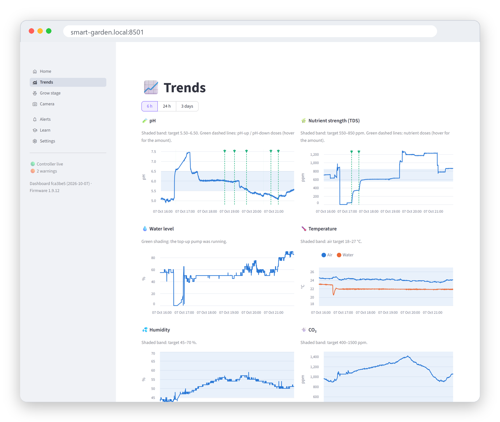
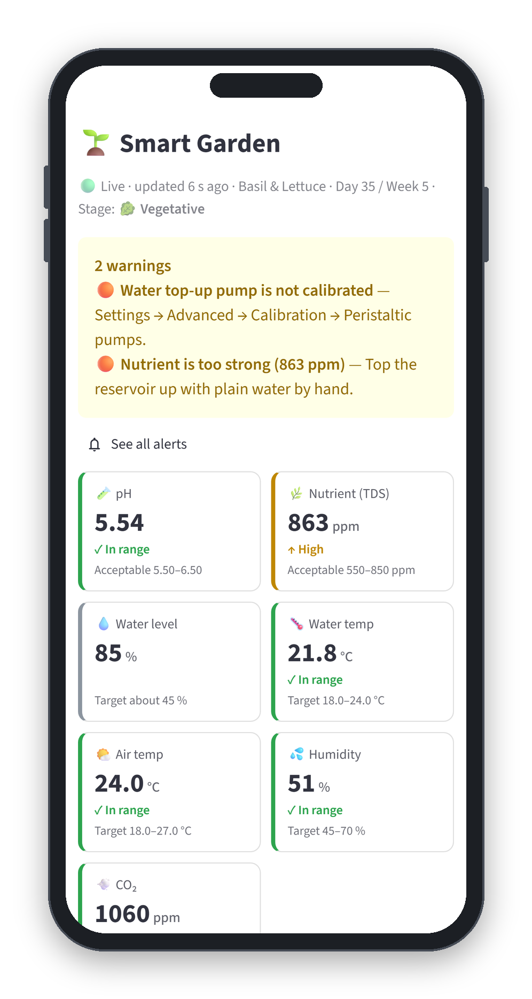
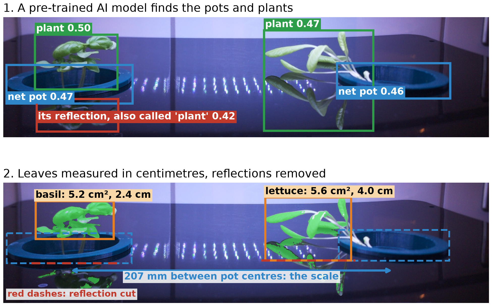

# Smart Garden IoT Dashboard

Raspberry Pi hub for an autonomous hydroponic garden: MQTT ingest, SQLite
history, a live Streamlit dashboard, alerting and plant-growth vision. It is
the ground-station half of the system. The ESP32 firmware and control design
are in **[embedded-smart-garden](https://github.com/s1j1k/embedded-smart-garden)**.

*Capstone project: Intelligent Closed-Loop Hydroponic Garden System.*

```
ESP32 node ──MQTT──▶ Mosquitto ──▶ ingest (single DB writer) ──▶ SQLite ──▶ Streamlit (public, read-only)
     │                   ▲                                              └─▶ Streamlit (admin, behind Cloudflare Access)
     └──HTTPS──▶ InfluxDB Cloud        └──── commands (setpoints, stages, calibration) ◀──┘
```

Highlights: one process writes to the database and the dashboards only read
it; readings carry `boot_id` + `seq` and are de-duplicated on ingest; the
public read-only site and the password-protected admin site are separated;
it runs as systemd services and Docker; push alerts go out through ntfy; Pi
camera growth tracking measures leaf area.

| Trends (desktop) | Home (phone) |
| --- | --- |
|  |  |



---

Production Streamlit dashboard for a Raspberry Pi 4 smart garden hub. The app:

- shows **live** hydroponic sensor readings from ESP32 garden nodes over MQTT
- stores every received payload locally (CSV export + SQLite) and charts history from SQLite and InfluxDB Cloud on startup, even if the ESP32 is offline
- shows **no sample / demo values** — live metrics update only while the node is publishing
- has a **Camera** page for Pi camera growth files (`data/camera/`), separate from MQTT telemetry
- raises faults, warnings and grow-stage reminders, pushed to phone and computer through ntfy
- installs as an app on phones and computers (PWA)

`main` is the production MQTT-only path. SAMPLE / SIMULATION / data-source
switching are preserved on the `demo` branch.

## Access and deployment (Raspberry Pi)

| What | Where |
|---|---|
| Dashboard (browser) | Public, readings only: **https://smartgarden.tech** (LAN: http://192.168.4.30:8501). Admin, every control, password: **https://admin.smartgarden.tech** (LAN: http://192.168.4.30:8502). See [Public and admin sites](#public-and-admin-sites). |
| Pi login | `ssh -i ~/.ssh/smart_garden_pi admin@192.168.4.30` |
| MQTT broker | `192.168.4.30:1883` (Mosquitto on the Pi; the ESP32 uses `smart-garden.local`) |
| Code on the Pi | a git clone of this repo, `main` branch |
| Passwords and tokens | **`.env.pi`** in this folder — git-ignored, never committed. Template: [`.env.pi.example`](.env.pi.example). On Windows the secrets are DPAPI-encrypted for your user; read one with `.\scripts\pi-secret.ps1 PI_PASSWORD`. |

The Pi runs these systemd services (unit files in `deploy/systemd/`):

| Service | Runs | Logs |
|---|---|---|
| `smart-garden-ingest` | `scripts/mqtt_to_sqlite.py`: the only writer of `data/sensor_readings.sqlite` and the CSV log | `journalctl -u smart-garden-ingest -f` |
| `smart-garden-dashboard` | `streamlit run src/server.py` on :8501, the public site (`SMART_GARDEN_SITE=public`: no controls) | `journalctl -u smart-garden-dashboard -f` |
| `smart-garden-admin` | the same app on :8502, the admin site (`SMART_GARDEN_SITE=admin`, password) | `journalctl -u smart-garden-admin -f` |
| `smart-garden-notifier` | `scripts/alert_notifier.py` (always-on alert push) | `journalctl -u smart-garden-notifier -f` |
| `smart-garden-detector` | `scripts/locate_plants.py` (pre-trained net-pot detector every 3 h; Pi with 3.5 GB+ RAM only) | `journalctl -u smart-garden-detector -f` |
| `smart-garden-timelapse` | `scripts/build_timelapse.py` (brings the timelapse video up to the latest photo every hour; needs ffmpeg) | `journalctl -u smart-garden-timelapse -f` |
| `smart-garden-camera` | `src/camera_capture.py` (Pi camera, driven by the Camera page; flashes the grow light white for each photo) | `journalctl -u smart-garden-camera -f` |

They restart by themselves if they stop and start at boot. Their state is
shown in the dashboard under **Settings → Advanced → Device status**, and the
Camera page says when the camera service is down.

**Deploy the latest code** (push to GitLab `main` first):

```bash
ssh -i ~/.ssh/smart_garden_pi admin@192.168.4.30
cd <dashboard folder on the Pi>
./scripts/deploy-pi.sh
```

`deploy-pi.sh` pulls `main` from GitLab, updates the Python packages, installs
the four unit files and restarts the services, then prints their state and the
dashboard health check. Pulls authenticate with a GitLab token stored once on
the Pi in `~/.git-credentials` (`./scripts/deploy-pi.sh --token-stdin`, token on
stdin), never in the repo or the remote URL. Readings, camera images and
settings under `data/` are untracked and survive every deploy.

## Dashboard Features

The dashboard is organised for the gardener first. A side menu (a ☰ button on a
phone) has icons for each area:

| Page | What it is for |
|---|---|
| 🏠 **Home** | Is everything OK? Alert summary, one tile per reading (pH, nutrient, water level, water and air temperature, humidity, CO₂) coloured by whether it is in the stage's target range, the glowing **grow-light photoperiod** timeline (on / dark period and when it next switches), the latest camera photo and dosing-bottle levels. |
| 📈 **Trends** | One chart per measurement, each with its own unit and target band: pH (with pH-dose shading), TDS (nutrient-dose shading), water level (top-up pump shading), air + water temperature, humidity, CO₂, and the light sensor (grow-light shading). 6 h / 24 h / 3 days. Sensor-error values (pH −9.8, water −127 °C) are left out, and lines break where readings stopped for more than 2 h. |
| 🪴 **Grow stage** | Current stage vs the stage plant age suggests, a **checklist of what to look for** before moving to the next stage next to the latest photo, a **suggested-vs-actual stage chart** (plant-age prediction dashed, real switch times as dots, camera green coverage underneath), and the control to apply a new stage. Plant targets (pH / EC from the plant catalogue) sit in an expander here, chosen on a top-down drawing of the laser-cut lid: hover over a net pot and click to pick its plant (`src/lid_view.py`; saved as `pots` in `data/garden_settings.json`). |
| 📷 **Camera** | Live viewfinder (plants boxed) to line the camera up, start / pause the 5-minute timelapse, growth metrics. |
| 🔔 **Alerts** | Every active fault, warning and reminder with what to do; notification set-up for this device and for phone / computer (ntfy); the full alert reference. |
| 📚 **Learn** | Why pH, TDS/EC, the grow light, water level, water and air temperature, humidity, CO₂, the light sensor and the camera matter for plant growth. |
| ⚙️ **Settings** | *General*: planting date and plants (drive the stage suggestions), auto-refresh, how to install the app. *Advanced*: device status lights and control schedule, **Run control cycle now**, pH and pump calibration wizards, stage threshold tables, MQTT connection, raw data tables and CSV download. |

Other behaviour:

- MQTT-only live telemetry from ESP32 garden nodes; no sample or demo values. Startup loads stored history from local SQLite and, when credentials are present, InfluxDB Cloud, so charts work while the ESP32 is offline.
- Installable as an app on phones and computers (PWA) — see [Install as an app](#install-as-an-app-pwa).
- Alerts reach the gardener whether or not the dashboard is open — see [Alerts and notifications](#alerts-and-notifications).
- Light and dark mode follow the device; the layout reflows for phone widths.
- Readings the ESP32 recorded while MQTT was down arrive later marked `"replay": true` (firmware 1.6.2+). They go into the charts and SQLite at their own time and never overwrite the live values.
- Status lights (Settings → Advanced → Device status): blue = OK, red = fault, amber = init required / warming up / held, grey = no comms or disabled, each with the firmware's reason (firmware 1.6+ `health` / `health_msg`). The **Readings, checks and dosing** panel there shows each loop's next check, dose threshold and hold reason (firmware `sched`).
- **Run control cycle now** sends `{"cmd":"cycle"}`: one pass of water level → nutrient (EC) → pH. Nutrient is always dosed first; pH is dosed only once the TDS loop has finished with TDS in range, because the concentrate shifts pH (unless a fault stops the TDS loop). From firmware 1.9.23 a cycle also starts by itself as soon as a reading leaves its dead limits; there is no fixed timer.
- CSV logging of MQTT readings (ISO-8601 UTC, empty = NULL, pumps as `0`/`1`) with download in Settings → Advanced → Data.
- Auto-refresh reruns only the live sections (2 s; charts every 30 s; camera every 15 s), so the page does not jump while you scroll.

## Project Layout

```text
src/server.py          Entry point: st.App wrapping app.py with the PWA routes
src/app.py             Side navigation, sidebar status, device notifications
src/views/             One module per page (home, trends, stage, alerts_page, learn,
                       settings, calibration)
src/core.py            Session state, MQTT polling, command publishing, live context
src/alerts.py          Alert engine + CATALOGUE of every alert (shared with the notifier)
src/notifier.py        Push decisions (delay / repeat / resolved) and ntfy delivery
src/browser_notify.py  System notifications on the device that has the dashboard open
src/growth_targets.py  Climate ranges per stage, stage-change hints, stage timelines
src/readings.py        Home-page reading tiles and their in-range status
src/charts.py          Altair charts: one unit per chart, target bands, activity shading
src/garden_settings.py Planting date, plants and notification settings (data/garden_settings.json)
src/pwa.py             Manifest, service worker, icons and head tags for the installable app
src/pwa_assets/        Icons, sw.js and the offline page
src/grow_light_panel.py  Grow-light photoperiod card
src/status_panel.py    Status lights + control schedule panel (health / sched telemetry)
src/sensor_ingest.py   shared MQTT subscriber, payload normalization, reading identity
src/sqlite_store.py    SQLite writer (raw mqtt_messages + sensor_readings, idempotent)
scripts/mqtt_to_sqlite.py  always-on ingest (systemd smart-garden-ingest), the only DB writer
scripts/dedupe_sqlite.py   one-off removal of repeated rows stored before the ingest service
src/history_loader.py  Startup charts from SQLite, then InfluxDB Cloud for the same window
src/schema.sql         documented SQLite tables (runtime migrates via sqlite_store)
src/config.py          defaults for dashboard, MQTT, grow-stage presets and log paths
src/camera_view.py     Camera page (viewfinder, start/pause timelapse)
src/camera_control.py  command.json / status.json shared by the dashboard and capture script
src/camera_capture.py  Pi camera loop (picamera2; only process that opens the camera)
src/camera_flash.py    Grow-light white flash around each photo (MQTT light_flash + ack)
src/timelapse_export.py  Zip / MP4 downloads of the photos so far
src/growth_detection.py  OpenCV green coverage and plant boxes (no trained model)
src/plant_growth.py    Per-plant growth and the random-forest stage estimate
src/plant_locator.py   Pre-trained net-pot / plant detector (Grounding DINO, Apache-2.0)
scripts/locate_plants.py  Runs it on the latest frame (smart-garden-detector service)
scripts/alert_notifier.py  Always-on MQTT → alerts → ntfy push service
scripts/make_pwa_icons.py  Redraws the app icons
scripts/deploy-pi.sh   Pull GitLab main on the Pi and restart the systemd services
deploy/systemd/        Unit files: dashboard, alert notifier, camera
src/services.py        systemd service state shown in the dashboard
src/simulation.py      offline model (used on demo branch)
src/control.py         simulation control logic (demo branch)
```

## Local PC bring-up (no Raspberry Pi)

### Windows (PowerShell)

One-time prerequisites (if not already installed):

```powershell
winget install --source winget Python.Python.3.12
winget install --source winget EclipseFoundation.Mosquitto
```

Close and reopen PowerShell so `python` / `mosquitto` are on PATH, then from
the dashboard repo root:

```powershell
.\scripts\run-local-dashboard.ps1
```

The winget Mosquitto Windows service defaults to **localhost-only**. The script
tries to stop it and restart with `docker/mosquitto.conf` (LAN bind) so the
ESP32 can connect. If that fails, run an elevated PowerShell once:

```powershell
Stop-Service mosquitto
Set-Service mosquitto -StartupType Manual
& "${env:ProgramFiles}\mosquitto\mosquitto.exe" -c .\docker\mosquitto.conf
```

### Linux / macOS / ChromeOS Linux

From the dashboard repo root:

```bash
./scripts/print-broker-ip-hint.sh   # how to set ESP32 MQTT_BROKER_HOST
./scripts/run-local-dashboard.sh    # Mosquitto (if needed) + Streamlit on :8501
```

Open **http://localhost:8501** → **Settings → Advanced → Calibration** for the
SEN0169 pH probe and the peristaltic pump cup wizard over MQTT.

ESP32 `secrets.h` must use this computer's **WiFi** IP on `HOME_WIFI`, not
`localhost` and not a ChromeOS Linux container address (`100.115.x.x`).
On Windows the script prints the LAN IP to use.
## Install as an app (PWA)

`src/server.py` serves the dashboard with a web-app manifest, a service worker
(`/sw.js`: offline page and notification taps) and home-screen icons, so it can
be installed:

- **Android (Chrome):** menu ⋮ → *Install app* / *Add to Home screen*.
- **iPhone / iPad (Safari):** Share → *Add to Home Screen*, then open it from the icon.
  iOS only shows web notifications for apps opened from the Home Screen (iOS 16.4+).
- **Computer (Chrome / Edge):** the install icon at the right of the address bar.

Browsers only install apps, run service workers and show notifications on a
**secure origin**: `https://…` or `http://localhost`. On the Pi's plain LAN
address (`http://192.168.x.x:8501`) the dashboard still works in the browser,
but cannot be installed and cannot notify — use the
[Cloudflare Tunnel](#remote-access-with-cloudflare-tunnel) HTTPS address (or any
HTTPS reverse proxy) for the app, and ntfy for always-on alerts.

`streamlit run src/app.py` still runs the dashboard, without the app shell.

## Alerts and notifications

One alert engine (`src/alerts.py`) turns the latest telemetry into **faults**
(something is broken or a reading cannot be trusted), **warnings** (the garden
needs attention) and **reminders**. The same alerts appear on the Home page,
the sidebar, the Alerts page, and in notifications.

Notifications reach the gardener two ways:

1. **Always on — ntfy (phone and computer).** `scripts/alert_notifier.py` runs
   next to the dashboard (the Docker image starts it), subscribes to MQTT,
   evaluates the alerts every 30 s and publishes to an [ntfy](https://ntfy.sh)
   topic. Install the ntfy app (Android / iOS) or open `ntfy.sh/app` in a
   desktop browser and subscribe to the topic set on **Alerts → Phone &
   computer** (or `NTFY_TOPIC`). This works with no dashboard tab open, and also
   when the controller itself goes silent (`node_offline`).
2. **While the dashboard is open — this device.** **Alerts → This device →
   Enable notifications** shows a system notification for each new alert on
   that phone or computer (needs HTTPS or localhost, see above).

A condition must last for its **push delay** before a notification is sent, so
one noisy reading does not page anyone. Active alerts are re-sent every 2 h
(faults), 12 h (warnings) or 24 h (reminders), and a "Resolved" message follows
when a pushed fault or warning clears. Choose faults only, faults + warnings, or
everything on the Alerts page; stage-change reminders can be switched on or off
separately.

| Alert | Type | When | What to do | Push delay |
|---|---|---|---|---|
| `node_offline` | Fault | No telemetry from the ESP32 for 90 s. | Check power and WiFi; `MQTT CONNECT` on the serial console. | 5 min |
| `sensor_fault.*` | Fault | The ESP32 marks a sensor FAULT (`ph`, `tds`, `water_level`, `water_temp`, `ambient`, `co2`, `light`) — e.g. no valid pH, stuck level stick, DS18B20 −127 °C. | Reseat / power-cycle the sensor; dosing ignores it until it clears. | 2 min |
| `implausible.*` | Fault | A reading is physically impossible: pH outside 0–14, water outside 0–45 °C, TDS outside 0–3000 ppm, humidity outside 0–100 %. | Check probe wiring and calibration. | 5 min |
| `bottle_empty.*` | Fault | A dosing bottle (`water`, `nutrient`, `ph_up`, `ph_down`) is estimated empty; that pump is stopped. | Refill, then `FILL` on the serial console. | now |
| `actuator_fault.*` | Fault | A pump, the grow light or auto control reports FAULT. | Check tubing and wiring. | 2 min |
| `grow_light_mismatch` | Warning | The grow light is on during its dark period or off during its day period. | Check the LED supply and the GPIO 27 data line. | 10 min |
| `uncalibrated.ph_probe` | Warning | The pH probe runs on default calibration. | Settings → Advanced → Calibration → pH probe. | 30 min |
| `uncalibrated.<pump>` | Warning | A dosing pump (`water`, `nutrient`, `ph_up`, `ph_down`) has no measured flow rate. | Settings → Advanced → Calibration → Peristaltic pumps. | 30 min |
| `water_level_init` | Warning | The water-level stick needs initialising; top-ups are paused. | Lift the stick out and lower it slowly back in. | 10 min |
| `session_near_cap.<loop>` | Warning | pH or nutrient dosing has used 80 % of its per-session limit. | Check the reading with a strip and that the pump line delivers. | now |
| `session_cap.<loop>` | Warning | pH or nutrient dosing reached its per-session limit and stopped. | Find out why (reading, dosing line); an admin can allow more dosing in Settings (`session_reset`). | now |
| `no_response.<pump>` | Fault | Several doses in a row did not move their reading (pH-up / pH-down: the pH, firmware 1.9.19+; nutrient: the TDS, 1.9.22+), so the firmware stopped that pump. | `PRIME PH_DOWN` / `PH_UP` / `NUTRIENT` on the serial console to check the pump turns and the line delivers; then Settings → clear the no-response stop. | now |
| `water_change_due` | Warning | The firmware's solution monitor (1.9.20+) says the nutrient solution needs replacing; the alert lists why (age, top-up turnover, pH reagent load, weak pH dose response, pH not holding, TDS high). | Drain and refill, then Settings → Nutrient solution → **Water changed**. | 1 h |
| `water_change_soon` | Info | One of those indicators is near its limit. | Plan a water change. | now |
| `bottle_low` | Warning | A dosing bottle is running low. | Refill soon, then `FILL`. | now |
| `control_held` | Warning | Auto control is held (calibration running, sensor warming up, bottle empty). | Read the reason; it clears by itself. | 30 min |
| `node_idle` | Warning | Plants are growing but the controller is idle (nothing dosed). | Grow stage → apply the suggested stage. | 1 h |
| `ph_out_of_range` | Warning | Control pH (3-min average) is outside the stage band (5.50–5.80). | Normally fixed by the next pH check; if not, check bottles and calibration. | 4 h (30 min below 5.0 / above 7.0) |
| `tds_low` | Warning | Control TDS below the stage band (transitional / vegetative / harvest). | The next EC check doses; check the nutrient bottle. | 6 h |
| `tds_high` | Warning | Control TDS above the stage's high limit — the ESP32 never dilutes. | Top up with plain water by hand. | 2 h |
| `water_low` | Warning | Water level at or below 10 % during a growth stage. | Refill the reservoir / water jug. | 15 min |
| `climate.air_temp_c` | Warning | Air temperature outside the stage range (seedling 20–26, transitional / vegetative 18–27, harvest 16–26 °C). | Adjust heating, ventilate, move out of sun. | 1 h |
| `climate.humidity_pct` | Warning | Humidity outside the stage range (seedling 60–80, transitional 50–75, vegetative 45–70, harvest 40–70 %). | Dome for seedlings; airflow when too damp. | 1 h |
| `climate.water_temp_c` | Warning | Water outside 18–24 °C (16–24 °C at harvest). | Shade the reservoir / keep it off warm or cold floors. | 1 h |
| `climate.co2_ppm` | Warning | CO₂ below 400 ppm (sensor reset likely) or above 1500 ppm (unventilated room). | Ventilate; reset the sensor if it reads below outdoor air. | 1 h |
| `stage_change_due` | Reminder | Plant age says the next stage is due (week 2 transitional, week 4 vegetative, week 7 harvest) but the controller is still on an earlier stage. | Grow stage → compare the photo with the checklist → apply. | now |
| `upload_fault` | Reminder | Cloud backup (InfluxDB) uploads are failing. | Readings are still stored locally; check WiFi / Influx token. | 1 h |

The climate ranges are for basil + lettuce (`src/growth_targets.py`); when the
controller is idle the range for the plant-age stage is used. While the
controller is offline only `node_offline` and `stage_change_due` are raised, so
old readings do not trigger fresh alerts. `tests/test_alerts.py` fails if an
alert is added to `CATALOGUE` without a row here.

## Grow stage guidance

Plant age (Settings → General → *Planted on*) suggests a stage: week 1
**seedling**, weeks 2–3 **transitional**, weeks 4–6 **vegetative**, week 7+
**harvest**. Nothing changes by itself — the Grow stage page shows what to look
for before switching:

| From → to | Usually | Look for |
|---|---|---|
| idle → seedling | transplant day | seedlings in net pots, reservoir filled, probe and pumps calibrated |
| seedling → transitional | day 7–10 | first true leaves open, roots out of the plug, upright seedlings |
| transitional → vegetative | day 21–28 | 3–4 sets of true leaves, white roots in the reservoir, TDS steady between doses |
| vegetative → harvest | from day 42 | basil 15–20 cm with 6+ leaf pairs or flower buds; lettuce heads full; camera plant area levelling off |

The **suggested vs actual** chart plots the plant-age prediction against the
stage switches the controller really made (from SQLite `sensor_readings.grow_stage`),
so early or late switches are easy to see.

## MQTT Data Flow

The **MQTT broker** runs on the same machine as the dashboard (this PC for
local bring-up, or the Raspberry Pi 4 in production):

1. Mosquitto MQTT broker on the LAN (`0.0.0.0:1883`, anonymous).
2. This Streamlit dashboard (subscribes on `localhost:1883`).

Each ESP32 connects to the same WiFi, connects to the **Pi’s LAN IP**, and
publishes JSON telemetry to:

```text
smart-garden/<device_id>/telemetry
```

The dashboard on the Pi subscribes to:

```text
smart-garden/+/telemetry
```

### One-time Mosquitto setup on the Pi

```bash
cd ~/smart-garden-iot-dashboard   # or your clone path
./scripts/setup-pi-mqtt-broker.sh
hostname -I   # put this IP into the ESP32 secrets.h as MQTT_BROKER_HOST
```

### ESP32 broker address

In the Arduino `secrets.h` (on your computer before flashing):

```cpp
const char* MQTT_BROKER_HOST = "smart-garden.local";  // Raspberry Pi mDNS name
```

The ESP32 resolves `smart-garden.local` via mDNS. If that fails, set
`MQTT_BROKER_HOST` to the Pi LAN IP from `hostname -I` instead. Do not use
`localhost` on the ESP32.

### Serial link over the USB cable

When the ESP32's WiFi cannot reach the Pi (UniWireless blocks mDNS, and the
project box weakens the signal), plug its USB cable into the Pi. The
`smart-garden-serial-bridge` service (`scripts/serial_mqtt_bridge.py`) then
carries its MQTT messages over the cable with firmware 1.9.29 or later:
telemetry, alerts and acks are published to Mosquitto under the usual
topics, and commands on `smart-garden/+/cmd` go down the cable while the node
reports it is on the serial link. The node's Serial log is kept in
`data/esp32_serial.log`. To flash over the same cable, copy the app image
from `arduino-cli compile` (`build/embedded-smart-garden.ino.bin`) to the Pi
and run `./scripts/flash_esp32_from_pi.sh <file>`.

## Telemetry and storage

Live control stays on the ESP32. This dashboard records what the node publishes
and can send commands back. Camera growth is a separate file store.

| What | Where | Written by | Read by the dashboard |
| --- | --- | --- | --- |
| Live telemetry | MQTT `smart-garden/<device_id>/telemetry` | ESP32 | Home readings while the node is publishing |
| Control events | MQTT `smart-garden/<device_id>/events` (firmware 1.8.0+) | ESP32 | Stored in `mqtt_messages` |
| Commands | MQTT `smart-garden/<device_id>/cmd` | Dashboard (stage, plant setpoints, pH cal, pump cal) | ESP32 |
| Normalized readings | `data/sensor_readings.csv` | `smart-garden-ingest`, one row per new reading | **Download raw sensor CSV** |
| Raw MQTT payloads | `data/sensor_readings.sqlite` table `mqtt_messages` | `smart-garden-ingest`, every topic under `smart-garden/#`, including payloads that fail JSON parse | Not charted; full JSON archive |
| Normalized readings | `data/sensor_readings.sqlite` table `sensor_readings` | `smart-garden-ingest`, same moment as the CSV row | Startup history and charts |
| Cloud backup | InfluxDB Cloud measurement `sensor_reading`, device `garden-node-01` | ESP32 (not this app) | Startup history for the same lookback window |
| Camera control | `data/camera/command.json` | Dashboard (**Open viewfinder**, **Use this position**, **Start** / **Pause**) | `src/camera_capture.py` |
| Camera status | `data/camera/status.json`, `preview/frame.jpg` (deleted when the viewfinder closes) | `src/camera_capture.py` on the Pi | **Camera** page |
| Camera growth | `data/camera/growth.csv`, `plants.jsonl`, `latest.jpg`, `latest_plants.jpg`, `images/`, `debug/` | Timelapse frames | **Camera** page only |

**One writer, one subscriber, no repeats.** Only `smart-garden-ingest`
writes SQLite and the CSV. The dashboard opens **one** MQTT session per
process (`shared_mqtt_client` in `src/sensor_ingest.py`), and every browser
tab reads from it with its own cursor. (Before this, each open tab made its own
subscriber and each one stored every message: the Pi had up to 14 copies of a
reading and 16 broker clients.) A local run without the ingest service still
stores from the dashboard (`SMART_GARDEN_DASHBOARD_PERSIST` defaults to `1`).

From firmware 1.8.0 every reading carries `boot_id` and `seq`, and every
control event carries `boot_id` and `event_seq`. The ingest stores
`reading_key = "<device_id>/<boot_id>/<seq>"` (unique in `sensor_readings`)
and `msg_key` (unique in `mqtt_messages`), with `INSERT OR IGNORE`. A replay
of a reading that had already arrived is counted as a repeat (`repeats=` in
the ingest log) and not written. Status snapshots after a command have no
`seq` and are all kept. A gap in `seq` within one `boot_id` means a reading
never arrived live; it is still in the ESP32 journal (`DUMP SENSORS`).

Rows stored before this change are cleaned with
`scripts/dedupe_sqlite.py`. It does a dry run unless you pass `--apply`, then
writes a backup next to the database before deleting. Stop the services
first:

```bash
sudo systemctl stop smart-garden-ingest smart-garden-dashboard smart-garden-admin
.venv/bin/python scripts/dedupe_sqlite.py            # counts only
.venv/bin/python scripts/dedupe_sqlite.py --apply --vacuum
sudo systemctl start smart-garden-ingest smart-garden-dashboard smart-garden-admin
```

Default lookback is 72 hours, capped at 4000 rows (`history_lookback_hours`,
`history_max_rows` in `src/config.py`). SQLite is loaded first. Influx rows
fill the same window when `INFLUX_URL`, `INFLUX_ORG`, `INFLUX_BUCKET`, and
`INFLUX_TOKEN` are set in the environment or in
`../embedded-smart-garden/secrets.h` (or `./secrets.h`). If both stores have
the same timestamp, the SQLite row is the one charted. A missing broker, a
missing Influx token, or an offline ESP32 does not hide the other store.

CSV columns match `src/schema.sql` / `sensor_readings`:

- header row uses snake_case column names
- `received_at` / `timestamp` are ISO-8601 UTC (`YYYY-MM-DDTHH:MM:SSZ`)
- missing values are empty cells (SQL NULL), not `None` / `NaN` text
- actuator flags are `0` or `1`
- UTF-8, comma-separated, `\n` line endings

`data/*.csv` and `data/*.sqlite` are gitignored. Camera images and
`data/camera/growth.csv` are gitignored too.

## Expected ESP32 MQTT Payload

Publish UTF-8 JSON. These sensor fields are required:

```json
{
  "device_id": "garden-node-01",
  "timestamp": "2026-08-04T06:45:00Z",
  "ambient_temp_c": 24.7,
  "ambient_humidity_pct": 61.3,
  "water_temp_c": 21.5,
  "light_adc": 1820,
  "water_level_pct": 28.0,
  "tds_ppm": 310,
  "ph": 5.65,
  "co2_ppm": 455
}
```

Optional grow-stage / control metadata:

```json
{
  "grow_stage": "seedling",
  "hydroponic_mode": "kratky",
  "ph_settle_s": 64800,
  "water_target_pct": 30,
  "water_max_pct": 50,
  "nutrient_tds_min": 200,
  "nutrient_tds_max": 400,
  "ph_target_min": 5.5,
  "ph_target_max": 5.8,
  "ph_dose": "none",
  "nutrient_dose": "none"
}
```

Grow stages match the ESP32 firmware: `idle` (default until set),
`sensor_baseline`, `filling`, `ph_baseline`, `seedling`, `transitional`,
`vegetative`, and `harvest`. The chosen stage is stored on the ESP32 LittleFS
and survives reboot. Change it from the **Grow stage** page
(`{"cmd":"stage","value":"seedling"}`) or Serial `MODE SEEDLING`. The
dashboard also suggests a stage from plant age (week 1 seedling, weeks 2–3
transitional, weeks 4–6 vegetative, week 7+ harvest) and does not apply that
suggestion by itself; see [Grow stage guidance](#grow-stage-guidance).

`hydroponic_mode` is `kratky` (passive, 18 h pH re-dose wait) or `dwc`
(air stone, 30 min wait). Change `ACTIVE_HYDROPONIC_MODE` on the ESP32
after the air stone is installed — the dashboard only displays the mode.

`control_law` is `threshold`, `P`, `PI`, or `PID`. Peristaltic pump
calibration is available on the dashboard **Calibration → Peristaltic pumps**
tab (`{"cmd":"pump_cal",…}`) and still works over Serial (`CAL WATER`, …).
A human must confirm the 10 mL cup is on the outlet before **Run**.

Optional actuator state fields:

```json
{
  "water_pump_on": false,
  "drain_pump_on": false,
  "nutrient_pump_on": false,
  "ph_up_pump_on": false,
  "ph_down_pump_on": false,
  "led_on": false,
  "fan_on": false
}
```

`led_on` (grow light) and `fan_on` are optional placeholders for hardware that
is not on the node yet. When those fields are omitted, the dashboard shows
**Not received** instead of treating them as OFF.

Field aliases accepted by the dashboard:

- `ambient_temp_c`, `temperature`, `temperature_c`, or `temp_c`
- `ambient_humidity_pct`, `humidity`, or `humidity_percent`
- `water_temp_c`, `water_temperature`, or `water_temperature_c`
- `light_adc`, `ldr_adc`, `light_intensity`, `light_lux`, or `lux`
- `water_level_pct`, `water_level`, or `water_level_percent`
- `tds_ppm`, `tds`, or legacy `ec` / `ec_ms_cm` (converted with ×500)
- `ph` or `pH`
- `co2_ppm`, `co2`, or `CO2`
- `water_pump_on` or `pump_on`
- `led_on`, `grow_light_on`, or `growlight_on` (optional — Not received if omitted)
- `fan_on` (optional — Not received if omitted)
- Grow light photoperiod (optional): `grow_light_mode`, `grow_light_photoperiod_h`,
  `grow_light_schedule_start_utc`, `grow_light_ntp_schedule`, and from firmware 1.6.3
  `grow_light_want_on`, `grow_light_schedule_off_utc`, `grow_light_next_change_s`.
  The Home page **Grow light photoperiod** card draws today's ON / dark windows
  in local time and says when the light next switches.
- `timestamp` ISO-8601 string or Unix epoch seconds

Recommended publish interval: 5 to 30 seconds per ESP32 node.

Recommended MQTT quality of service: QoS 0 for frequent telemetry, QoS 1 if readings are infrequent and must not be missed.

## ESP32 Implementation Notes

The companion Arduino sketch in `smart-garden` already publishes this payload when
`ENABLE_MQTT` is set to `1`. Configure:

- `WIFI_SSID` / `WIFI_PASSWORD`
- `MQTT_BROKER_HOST` (Raspberry Pi IP)
- topic `smart-garden/garden-node-01/telemetry`

Arduino libraries: `PubSubClient`, `ArduinoJson`, plus the existing sensor libraries.

Arduino-style publish example:

```cpp
JsonDocument doc;
doc["device_id"] = "garden-node-01";
doc["timestamp"] = currentIsoTimestamp();
doc["grow_stage"] = "seedling";
doc["ambient_temp_c"] = ambientTempC;
doc["ambient_humidity_pct"] = ambientHumidityPct;
doc["water_temp_c"] = waterTempC;
doc["light_adc"] = ldrADC;
doc["water_level_pct"] = waterLevelPercent;
doc["tds_ppm"] = tdsPPM;
doc["ph"] = phValue;
doc["co2_ppm"] = co2PPM;
doc["water_pump_on"] = waterRefillPumpRunning;
doc["nutrient_pump_on"] = nutrientDosing;
doc["ph_up_pump_on"] = phDosingUp;
doc["ph_down_pump_on"] = phDosingDown;

serializeJson(doc, buffer);
mqtt.publish("smart-garden/garden-node-01/telemetry", buffer);
```

## Run Locally

```bash
python3 -m venv .venv
source .venv/bin/activate
pip install -r requirements.txt
streamlit run src/server.py
python scripts/alert_notifier.py   # optional: always-on push alerts
```

Open the displayed Streamlit URL. The dashboard connects to MQTT (`localhost:1883` by default) and waits for ESP32 telemetry — it does not show sample data.

That is the public site (no Settings, no controls). For everything, set a
password once and run the admin site:
`python scripts/set_admin_password.py`, then
`SMART_GARDEN_SITE=admin streamlit run src/server.py` and log in.

## Raspberry Pi 4 Docker Container

If you do not want to run tests or dependencies directly on your machine, use the Docker setup. It builds an ARM64 Linux container based on Debian Bookworm, which is the closest practical container match for 64-bit Raspberry Pi OS because Raspberry Pi OS is Debian-based.

What the container includes:

- `linux/arm64` target platform for Raspberry Pi 4-style architecture testing
- Python 3.11
- Streamlit dashboard
- Mosquitto MQTT broker
- Mosquitto client tools
- App dependencies from `requirements.txt`
- persistent host-mounted `./data` folder for CSV, SQLite, and camera files

What it does not emulate:

- Raspberry Pi GPIO hardware
- real WiFi radio behavior
- ESP32 devices
- exact Raspberry Pi kernel/device tree

Build and run:

```bash
docker compose up --build
```

Open the dashboard:

```text
http://localhost:8501
```

MQTT broker inside the container:

```text
localhost:1883
```

Publish a test message into the container:

```bash
docker compose exec smart-garden-pi mosquitto_pub -h localhost -t smart-garden/garden-node-01/telemetry -m '{"device_id":"garden-node-01","timestamp":"2026-08-04T06:45:00Z","ambient_temp_c":24.7,"ambient_humidity_pct":61.3,"water_temp_c":21.5,"light_adc":1820,"water_level_pct":28.0,"tds_ppm":310,"ph":5.65,"co2_ppm":455,"grow_stage":"seedling","water_pump_on":false,"nutrient_pump_on":false,"ph_up_pump_on":false,"ph_down_pump_on":false}'
```

Run a Python compile check inside the ARM64 container:

```bash
docker compose exec smart-garden-pi python -m py_compile src/*.py
```

Stop the container:

```bash
docker compose down
```

If your Docker host is not ARM64, Docker Desktop or Docker Buildx may use QEMU emulation. The build will be slower, but it is useful for catching dependency and runtime issues before deploying to the actual Pi.

## Deploy on Raspberry Pi 4

These steps assume Raspberry Pi OS Lite or Desktop, Python 3, and the Pi connected to the same WiFi network as the ESP32 devices.

1. Update the Pi:

```bash
sudo apt update
sudo apt upgrade -y
sudo apt install -y python3-venv python3-pip mosquitto mosquitto-clients git
```

2. Enable and start Mosquitto:

```bash
sudo systemctl enable mosquitto
sudo systemctl start mosquitto
```

3. Clone the project:

```bash
cd /home/pi
git clone <your-repo-url> smart-garden-iot-dashboard
cd smart-garden-iot-dashboard
```

4. Install Python dependencies:

```bash
python3 -m venv .venv
source .venv/bin/activate
pip install --upgrade pip
pip install -r requirements.txt
```

5. Run the dashboard:

```bash
streamlit run src/server.py --server.address 0.0.0.0 --server.port 8501
```

6. Open the dashboard from another device on the same network:

```text
http://<raspberry-pi-ip>:8501
```

7. In the sidebar, confirm MQTT settings (defaults are correct on the Pi):

```text
Host: localhost
Port: 1883
Topic: smart-garden/+/telemetry
```

The UI stays empty (—) until the ESP32 publishes. There is no SAMPLE fallback on `main`.

## Public and admin sites

The dashboard runs twice, from the same code:

| Site | Port | Hostname | Shows |
|---|---|---|---|
| Public | 8501 | `smartgarden.tech` | Home, Trends, Grow stage, Camera, Alerts, Learn: readings, charts and photos only |
| Admin | 8502 | `admin.smartgarden.tech` | Everything, including Settings, calibration, stage changes, camera controls, photo downloads and notification set-up |

The public site never draws a button or form that could change the Pi or the
controller, and has no Settings page. On the admin site every request, the live
connection included, needs a login cookie (30 days, `HttpOnly`); without one the
browser gets `/login`. After 10 wrong passwords in 15 minutes logins are refused
until the 15 minutes pass. **Log out of admin** is at the bottom of the sidebar.

Set or change the password on the Pi (no restart needed; it logs every browser out):

```bash
cd ~/smart-garden-iot-dashboard
.venv/bin/python scripts/set_admin_password.py              # type it
.venv/bin/python scripts/set_admin_password.py --generate   # or make a random one
```

Only a scrypt hash is stored, in `.streamlit/secrets.toml` (git-ignored). With no
password set, the admin site lets nobody in.

**Cloudflare set-up** (the [`smart-garden` tunnel](#the-smart-garden-named-tunnel)):

1. Zero Trust → Networks → Tunnels → smart-garden → *Public hostnames*:
   `smartgarden.tech` → `http://localhost:8501`, and add
   `admin.smartgarden.tech` → `http://localhost:8502`.
2. SSL/TLS → Edge Certificates: *Universal SSL* must be enabled and its
   certificate **Active** (it covers `smartgarden.tech` and `*.smartgarden.tech`).
   Turn on *Always Use HTTPS*.
3. Optional, stronger: Zero Trust → Access → Applications → self-hosted app for
   `admin.smartgarden.tech` with an email one-time-PIN policy, in front of the password.

## Remote access with Cloudflare Tunnel

Use this when teammates need the dashboard from outside the LAN. Only tunnel the
Streamlit UIs (`8501` public, `8502` admin). Keep Mosquitto (`1883`) on the local network — do not
expose the MQTT broker to the public internet.

### Install `cloudflared` on the Pi

SSH into the Raspberry Pi, then:

```bash
sudo mkdir -p --mode=0755 /usr/share/keyrings
curl -fsSL https://pkg.cloudflare.com/cloudflare-main.gpg | sudo tee /usr/share/keyrings/cloudflare-main.gpg >/dev/null

echo 'deb [signed-by=/usr/share/keyrings/cloudflare-main.gpg] https://pkg.cloudflare.com/cloudflared any main' | sudo tee /etc/apt/sources.list.d/cloudflared.list

sudo apt-get update && sudo apt-get install -y cloudflared
cloudflared --version
```

### The `smart-garden` named tunnel

The tunnel is managed in the Cloudflare dashboard (Zero Trust → Networks →
Tunnels → **smart-garden**). Its public hostnames send `smartgarden.tech` to
`http://localhost:8501` and `admin.smartgarden.tech` to `http://localhost:8502`
(see [Public and admin sites](#public-and-admin-sites)). The Pi only needs the
tunnel token, saved once:

```bash
./scripts/deploy-pi.sh --tunnel-token-stdin
```

Paste the token when asked (not shown on screen). It is the long string at the
end of the install command under the tunnel's *Configure* page; pasting the whole
`cloudflared service install …` command works too. It is saved to
`~/.cloudflared/smart-garden.token` (mode 600), and the script then deploys as usual.

From then on `deploy-pi.sh` installs the `smart-garden-tunnel` service
(`cloudflared tunnel run --token-file …`), checks it has connected to Cloudflare
and tries both HTTPS addresses. If the tunnel already runs as
`cloudflared.service` (from `cloudflared service install`), the script leaves that
alone and does not start a second one. Without a token, it stops the old
`trycloudflare.com` quick tunnel instead of leaving it running.

```bash
journalctl -u smart-garden-tunnel -f      # connection log
```

For a one-off test without the named tunnel:
`cloudflared tunnel --url http://localhost:8501` prints a temporary
`https://….trycloudflare.com` address for the public site.

### Security notes

- The admin hostname is the only way in from outside to the controls; it needs the
  admin password.
- Cloudflare Access in front of `admin.smartgarden.tech` adds a second check.
- Never publish Mosquitto (`1883`) through the tunnel — ESP32 devices stay on
  the same WiFi / LAN as the Pi.

## Testing MQTT Manually

From the Raspberry Pi, publish a test reading:

```bash
mosquitto_pub -h localhost -t smart-garden/garden-node-01/telemetry -m '{"device_id":"garden-node-01","timestamp":"2026-08-04T06:45:00Z","ambient_temp_c":24.7,"ambient_humidity_pct":61.3,"water_temp_c":21.5,"light_adc":1820,"water_level_pct":28.0,"tds_ppm":310,"ph":5.65,"co2_ppm":455,"grow_stage":"seedling","water_pump_on":false,"drain_pump_on":false,"nutrient_pump_on":false,"ph_up_pump_on":false,"ph_down_pump_on":false}'
```

You can also watch messages:

```bash
mosquitto_sub -h localhost -t 'smart-garden/+/telemetry' -v
```

## Camera on the Raspberry Pi

On the Pi the camera runs as the `smart-garden-camera` service (see
[Access and deployment](#access-and-deployment-raspberry-pi)); it needs:

```bash
sudo apt install -y python3-picamera2 python3-opencv
```

**Flash for every photo.** Before each timelapse frame the
capture script sends `{"cmd":"light_flash","action":"on"}` over MQTT. The ESP32
(firmware 1.7+) turns the grow light white (40 % — the most the 3 A LED buck
allows at the WS2812B worst-case draw), answers on
`smart-garden/<device>/ack`, the camera shoots, then sends `"off"` on the same
MQTT connection and the light returns to exactly what it was doing
(day blurple, night dark, mid-fade). The firmware ends the flash by itself
after 15 s if "off" is lost. If the ESP32 does not answer within 3 s the photo
is taken without the flash. `CAMERA_FLASH=0` turns the flash off.

Exposure under the flash is fixed, day and night, at 15 ms and gain 1.12
(`CAMERA_FLASH_EXPOSURE_US`, `CAMERA_FLASH_GAIN`), set before the light comes
on. Auto-exposure gave that for daytime frames, but in the dark it ramped to
about 66 ms and ISO 950 and could not come back within the flash, so night
photos were blown out and blurred. By day each photo starts with one autofocus
sweep under the white light (the Camera Module 3 otherwise stays at its default
lens position, which blurs close plants). The `"off"` ack says whether the grow
light went back to dark; while it is dark the photo reuses the last daytime lens
position instead of sweeping, so a night flash is under a second, and photos
are taken every 30 minutes (`CAMERA_NIGHT_INTERVAL_S`), since each flash breaks
the plants' dark period (lettuce is a long-day plant).

The script starts **paused**. Open the dashboard **Camera** page on the same
machine (both processes must share this repo's `data/camera/` folder).
**Open viewfinder** shows live frames (about one a second) with the grow light
held white, focus continuous and each plant boxed, so you can line the camera
up. **Use this position — start timelapse** closes it and starts the
timelapse; **Close viewfinder** just closes it. Viewfinder frames overwrite one
file in `data/camera/preview/`, which is deleted when the viewfinder closes, so
none are ever kept. The viewfinder closes itself after 10 minutes. The
timelapse saves one still every 5 minutes (`CAMERA_CAPTURE_INTERVAL_S`
overrides that, in seconds); the JPEGs in `data/camera/images/` are the reel.

**Plant detection** (`src/growth_detection.py`) is classical OpenCV image
processing, with no trained model. Green coverage and plant area (logged since
the start of the trial) come from a fixed HSV green range over the whole frame.
Leaf pixels come from the a* (green to magenta) axis of Lab colour, which keeps
the purple grow light, the lid, the wall and the teal net pots out and still
finds pale lettuce under the purple light. Leaf blobs are
grouped into `CAMERA_PLANT_COUNT` plants (default 2) by position, and small
blobs far from a plant are left out. `CAMERA_ROI="left,top,right,bottom"`
(fractions of the frame, e.g. `0,0,1,0.8`) limits the search, for example to
drop plant reflections in the glossy lid; the viewfinder outlines it.

**Pre-trained pot detector** (`src/plant_locator.py`, service
`smart-garden-detector` running `scripts/locate_plants.py`): Grounding DINO
(`IDEA-Research/grounding-dino-tiny`, Apache-2.0, via Hugging Face
`transformers`) finds the **net pots** and plants from a text prompt, with no
training on this garden. Colour alone cannot tell a plant from a teal pot or a
reflection; the model can. It takes minutes per photo on a Pi 4, and the pots do
not move, so it runs on the latest frame every 3 hours (`LOCATE_EVERY_S`) and on
the first frame after **Use this position**, at low priority on two cores, and
saves `data/camera/layout.json` and `layout.jpg`. Once pots are known there is one
box per pot (a pot can hold several seedlings; numbered by pot, so an empty pot
does not renumber the others), leaves go to the nearest pot, and the lid's
reflection is removed: the mirror line under each plant is the row near the pot
where the vertical edges above, flipped, best match those below, and green below
it is dropped (the pot's base if nothing matches). Without pots nothing is cut,
because without that prior the best match can slice through a real plant. Until then, or if no pots are found, plants are grouped by position. The
detector needs `requirements-ai.txt` (torch, transformers; ~1 GB with the model,
downloaded from Hugging Face on first run), which `deploy-pi.sh` installs only on
a Pi with 3.5 GB+ RAM. Try it on any photo:
`.venv/bin/python scripts/locate_plants.py --once photo.jpg`.

For each timelapse frame the capture script appends every plant's box, leaf
area, height, width and leaves seen to `data/camera/plants.jsonl` and saves the
frame with the boxes drawn as `data/camera/latest_plants.jpg`.

**Camera page, Each plant** (`src/plant_growth.py`, pandas / numpy /
scikit-learn, no OpenCV): the latest boxed frame, a table per plant (leaf area,
height, width, leaves seen, growth in area % per day over the last day) and
leaf-area and height charts per plant. **Camera stage estimate
(experimental)**: a random forest (100 trees) learns the growth stage from those
features, averaged per hour, labelled with the stage the controller was really
on at that hour (from the sensor log). It shows the stage it suggests for the
latest hour, how many trees agree, its accuracy with each whole day held out in
turn, and which features it relies on. It needs 3 labelled days covering 2
stages, retrains at most once an hour, and never changes the stage on the
controller. `train_classifier()` takes any per-hour label, so other classifiers
(plant health, harvest readiness) can be trained the same way.

**Downloads** (Camera page): *That day's photos (.zip)*, one day at a time
(built on disk in `data/camera/zips/`; a whole trial is several GB, more than
the Pi can hold in memory while sending it, so copy `data/camera/images/` off
with `scp` for everything), and *Timelapse video (.mp4)*, 24 photos per second,
1280 px wide. The `smart-garden-timelapse` service keeps
`data/camera/timelapse.mp4` up to the latest photo every hour
(`TIMELAPSE_EVERY_S`), and a download click adds any photos since. It is built a
day at a time (`data/camera/timelapse_days/`): only today's part is re-encoded
and the days are joined without re-encoding, so updates stay quick late in a
trial. The Camera page always shows the latest video and the photos it covers;
`timelapse.json` records exactly which photos are in it. Needs
`sudo apt install -y ffmpeg`. *Delete all photos*
(behind a confirmation) clears the reel, growth measurements, plant boxes, zips and video. This tab does not read a separate
`smart-garden-camera-monitoring` checkout until that capture process is
pointed at this repo.

## Notes

- MQTT requires the `paho-mqtt` package from `requirements.txt`.
- The dashboard subscribes to telemetry and publishes commands (grow stage, plant-catalogue setpoints, pH probe calibration, peristaltic pump calibration). It does not run the water / pH / nutrient control loop; that stays on the ESP32.
- For demos with SAMPLE / SIMULATION / data-source switching, use the `demo` branch.
- For production, configure Mosquitto authentication and avoid exposing port `1883` beyond the trusted local network.
